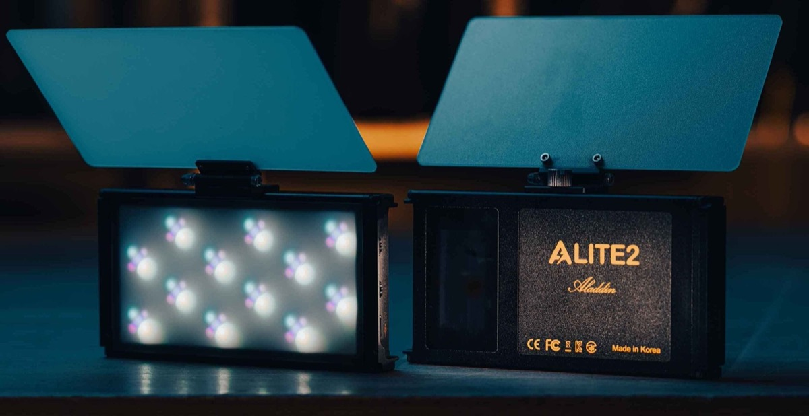
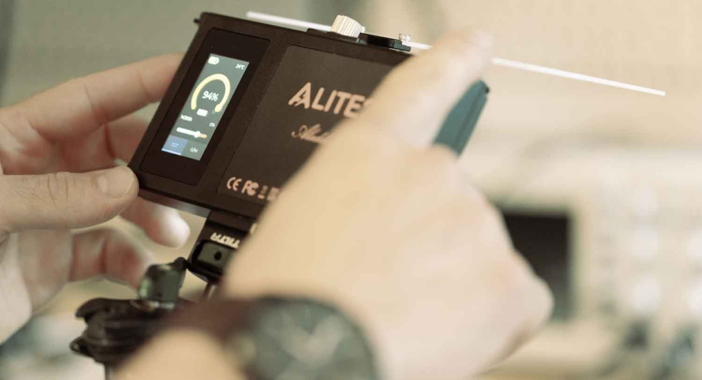
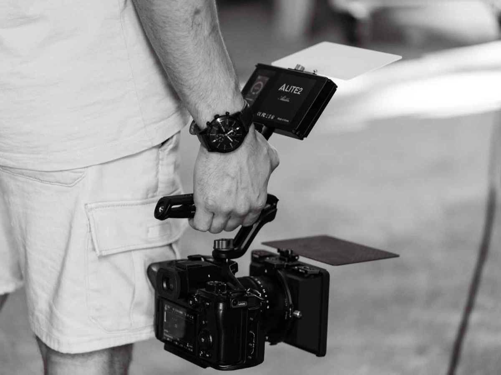
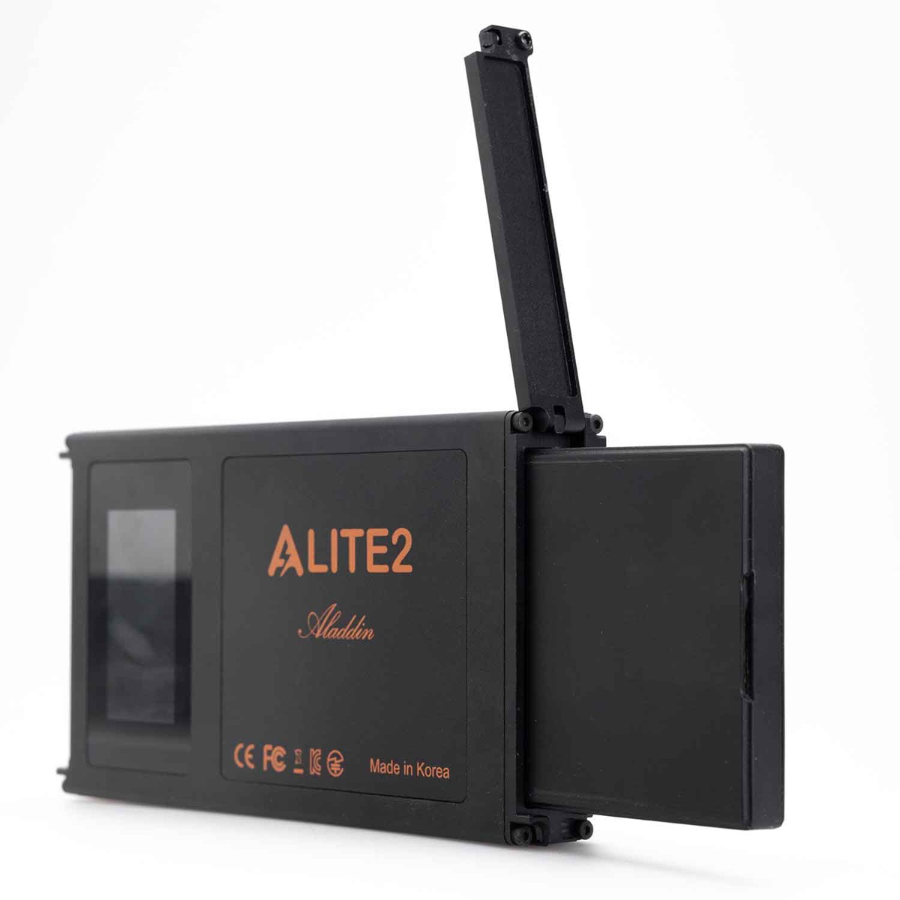
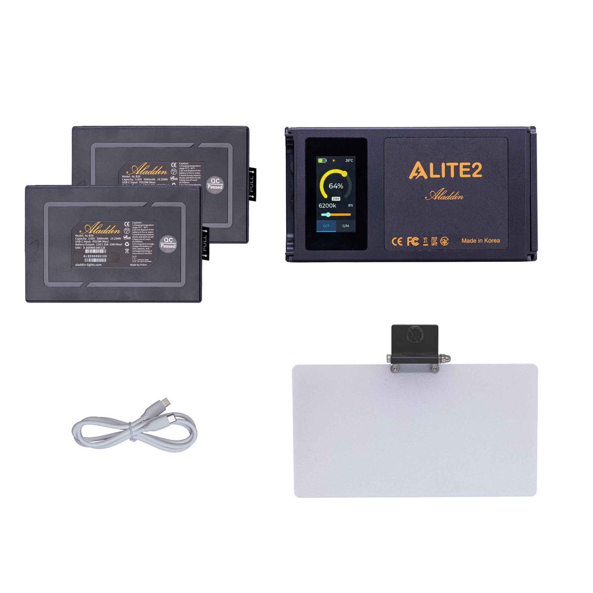

# Alite2Public — open firmware for the ALITE 2 LED light

> **Get an ALITE 2:** the light this firmware runs on is available from Aladdin Lights at
> **<https://aladdin-lights.com/a-lite-2/>**.



## About the ALITE 2

The ALITE 2 is a small, portable aluminium LED light from Aladdin. Its 15 W five-colour **CLAID** engine
(Cyan, Lime, Amber, Indigo, Deep Red) produces wide full-spectrum light, and it attaches with MagSafe and magnetic
accessories on the back.

| | |
|---|---|
| LED engine | CLAID 5-colour (Cyan, Lime, Amber, Indigo, Deep Red), 15 W |
| Wavelength range | 440 – 660 nm |
| CCT range | 1,700 K – 20,000 K |
| Colour quality | CRI 96–98 (R9/R15 95–99), TLCI 95–99, TM-30 Rf/Rg close to 100 |
| Control | Bluetooth (Lampora app for iOS / Android, Stream Deck), Art-Net over WiFi |
| Memory / effects | 6 memory slots (A–F), 3 pixel effects |
| Power | Detachable, replaceable battery (about 2 h), USB-C PD charging |
| Firmware | Wireless updates over WiFi |
| Accessories | Foldable diffuser included; magnetic diffuser and magnetic honeycomb grids (40° / 60°) |

<p>
  
  
</p>
<p>
  
  
</p>

Specifications and images: [aladdin-lights.com/a-lite-2](https://aladdin-lights.com/a-lite-2/). Kits, batteries,
diffusers and grids are sold there as well.

## What is Alite2Public?

Alite2Public is the ESP32-S3 firmware of the ALITE 2 (5-colour LED engine, 1.9" 170×320 LCD, rotary encoders,
BLE / Art-Net / sACN / LumenRadio) together with **Alite2 Studio**, a browser UI editor with an **MCP server**, so that
an AI coding assistant (Claude Code or Codex) can change the firmware and the on-screen UI for you, build it and
install it on your light over WiFi — **vibe coding for your own light**.

### What you can do with it

- **Redesign the screen UI** — move, resize and restyle widgets, change texts, colours, fonts and images, add
  screens and menu items, and see every change live in the browser editor.
- **Add your own light effects** — new effects (strobe, fire, police, custom chases …) with their own parameters and
  menu entries.
- **Change how the light behaves** — key and encoder functions, menus, default settings, colour modes, presets.
- **Add DMX / Art-Net charts** — define your own DMX personalities for Art-Net, sACN or LumenRadio.
- **Translate** — change or add Korean / Japanese texts.
- **Update over WiFi** — build and install on one or several lights from the browser, with progress per light,
  automatic rollback protection and a way back to the official firmware.

The LED calibration (`Alite2Calib`) and the BLE / WiFi / update layer (`Alite2Link`) are precompiled libraries: they
keep the LEDs within their safe output limits and keep the update path working, so a bad build can always be replaced.

## Quick start: run Alite2 Studio with an AI assistant (MCP)

Requirements: macOS or Linux, [arduino-cli](https://arduino.github.io/arduino-cli/latest/installation/),
Python 3, Node.js 18+, and [Claude Code](https://claude.com/claude-code) or the
[Codex CLI](https://github.com/openai/codex). Your light needs firmware **1.2.6 or later**.

```bash
git clone https://github.com/awkonly-design/Alite2Public.git
cd Alite2Public
./scripts/setup.sh                 # once: ESP32 core 3.0.2, pinned libraries, lv_conf.h

./ui_studio/run.sh claude          # start Claude Code with the Alite2 Studio tools (MCP) connected
# or
./ui_studio/run.sh codex           # the same with the Codex CLI
```

`run.sh claude` installs the editor's dependencies on first run, starts Claude Code in the repository (where
`.mcp.json` registers the `alite2-ui` MCP server — approve it on the first start) and opens **Alite2 Studio** at
<http://127.0.0.1:5190> as soon as the assistant's MCP server answers. `run.sh codex` passes the same server to Codex
on the command line. Then just describe what you want, for example:

- "Make the intensity number on MainScreen bigger and orange, then export and build."
- "Add a 'Strobe' effect with adjustable speed and show it in the effect list."
- "Add a DMX chart with 8-bit intensity, CCT and green/magenta."
- "Add a Korean translation for the new label."

The assistant edits the UI through the MCP tools (you watch the changes in the browser), changes the firmware code,
and builds it. To install it, press **▶ Build** in Alite2 Studio: when the build has finished press **Next**, tick
your lights and press **Upload**, then type the 8-character OTA password each light shows on its LCD
(**Setup → Radio**, at the bottom under the IP address).

Other `run.sh` modes: `./ui_studio/run.sh` starts only the editor (no AI), `./ui_studio/run.sh stop` stops it.

> **License:** personal use and modification on your own ALITE 2 only. Redistributing the source (modified or not),
> building other products from it, or any commercial use is not allowed. See [LICENSE](LICENSE) and
> [Commercial use](#commercial-use-is-not-allowed) below.
>
> **Certification:** the ALITE 2 is certified (KC / FCC / MIC) with its factory firmware. A unit running modified
> firmware is no longer the certified product and **must be re-certified**; operating it without re-certification
> is the modifier's responsibility. Selling, renting or transferring a modified unit is not allowed (see LICENSE).

## Repository layout

```
Alite2Public/
├── src/
│   ├── Alite2/            Arduino sketch (Alite2.ino + modules). Build target.
│   │   ├── config.h       ← your settings: Art-Net name, OTA host name / port, colour table
│   │   ├── ui_*.c / ui.h  generated by ui_studio (do not edit by hand)
│   │   └── fonts/         LVGL fonts (Latin + Korean + Japanese)
│   ├── libraries/Alite2Calib/  LED calibration library (precompiled binary + header)
│   ├── libraries/Alite2Link/   BLE / WiFi / OTA link layer (precompiled binary + header)
│   └── lv_conf.h          LVGL configuration (installed by scripts/setup.sh)
├── ui_studio/             Alite2 UI editor (browser) + MCP server for AI assistants
│   └── project/           the UI project: alite2_ui.json + assets/*.png
├── docs/BLE_PROTOCOL.md   BLE name, UUIDs, DMX charts, adding your own packets
├── scripts/               setup / build / upload / OTA / fonts
├── .mcp.json              registers the UI editor for Claude Code
├── CLAUDE.md, AGENTS.md   guidance for AI coding assistants
└── LICENSE                personal-use license
```

## 1. Setup (once)

Requirements: [arduino-cli](https://arduino.github.io/arduino-cli/latest/installation/), Python 3 (WiFi upload), Node.js 18+ (Alite2 Studio).

```bash
./scripts/setup.sh        # ESP32 core 3.0.2, pinned libraries, lv_conf.h
```

## 2. Build and flash

```bash
./scripts/build.sh                 # compile → build/Alite2.ino.bin
./scripts/upload.sh [serial-port]  # flash over USB (port is auto-detected if omitted)
```

Arduino IDE users: copy `src/libraries/Alite2Calib` into your Arduino `libraries` folder (the scripts pass it with `--libraries`).

Board settings (already in the scripts): ESP32S3 Dev Module, 16MB flash (QIO), 240 MHz, PSRAM disabled,
custom partitions (`src/Alite2/partitions.csv`: two 5MB OTA slots + 6MB file system).

## 3. Update over WiFi (OTA)

1. On the light: **Setup → Radio → Artnet**, press and hold F2. The light reboots in WiFi mode.
2. Give it WiFi credentials: **WiFi Setup** in Alite2 Studio (sends this computer's WiFi network to the light over
   Bluetooth, Chrome or Edge; the light must be in Bluetooth mode), BLE provisioning from your app, or
   `DEFAULT_WIFI_SSID/PASS` in `config.h`.
3. Its IP address appears at the bottom of the **Setup → Radio** page on the light's LCD, and directly under it the
   light's **8-character OTA password** (upper-case letters and digits). On the network it is called `Alite2-XXXXXX` (last 6 hex digits of its MAC), so several
   lights can be told apart. Then either press **▶ Build** in Alite2 Studio (section 4), press **Upload** and type each
   light's password in the password window, or:

```bash
./scripts/upload_ota.sh 192.168.0.42 K7QH4MZP      # IP and the password shown on that light
```

There is no fixed OTA password to set: every light makes its own, and it **changes when the light's IP address
changes** — read it off the light again after it got a new address. In recovery mode the light uses the last password
it showed on screen.
If a new build misbehaves, **Setup → H/W → Revert F/W** boots the previous OTA slot.

Your own firmware is updated only over USB or ArduinoOTA on your local network. The H/W page shows the version with
a build number, e.g. `1.2.5 (3)`: the number goes up each time a new firmware image starts on the light.

**Back to the official firmware:** **Setup → H/W → Upgrade F/W** (hold F2, WiFi mode, connected) downloads and installs
the official firmware from the manufacturer's update server. The LCD shows "LCD blinks while updating" and the
light restarts: while it downloads, the screen stays dark and the backlight blinks (this is normal). It works on lights that ran official firmware 1.2.6 or
later, which keeps the light's registration in its memory (it is not erased by a factory reset of the settings).
**Setup → H/W → Revert F/W** starts the firmware in the other update slot, which is the factory firmware after your
first update.

### First update of a light with the factory firmware

> **Light firmware 1.2.6 or later is required.** The light shows its WiFi OTA password on the LCD
> (Setup → Radio page, at the bottom under the IP address), and from 1.2.6 it can return to the official firmware
> with Setup → H/W → Upgrade F/W. Alite2Public can only be used on lights with firmware
> 1.2.6 or later.

Lights with factory firmware 1.2.6 or later appear on the network as `Alite2-XXXXXX` (listed as **New factory
firmware**) and show their own 8-character OTA password on the LCD: update them the same way as above.

Lights with older factory firmware appear as **`HDS-15W`**. They cannot be updated with Alite2Public: Alite2 Studio lists
them as **Old factory F/W** but does not let you select them. Update such a light to factory firmware 1.2.6 or later
first.

After the update the light runs this firmware: it appears as `Alite2-XXXXXX` and uses the password shown on its LCD.
Its WiFi access points, BLE pairing and settings are kept, and the colour table is chosen from the LED lot recorded
at the factory (`KELVIN_TABLE_SELECT -1`). **Setup → H/W → Revert F/W** switches back to the factory firmware as long
as no second update has replaced it.

### Update protection and recovery

A light cannot be opened to flash it over USB, so the `Alite2Link` library protects the WiFi update path:

- **Only firmware that contains Alite2Link is accepted.** A light rejects any other image during the upload
  (Alite2 Studio shows "Rejected by the light").
- **Kept at once.** A new firmware is kept as soon as it starts: switching the light off and on keeps it.
- **Boot loop.** Three quick crashes / restarts in a row: the light starts the previous firmware; if that loops too,
  it enters recovery mode.

In **recovery mode** your firmware does not run. The screen stays dark and the backlight blinks: two short blinks
while it connects, fast blinking once it is on WiFi. The light connects to its saved WiFi access points, and it also
accepts new ones from the app over BLE. It appears in Alite2 Studio's Build window as **Recovery mode**:
upload a working firmware and it restarts normally. Hold F1 for 2 seconds to switch it off.

## 4. See and adjust the screen UI, build and update over WiFi

```bash
./ui_studio/run.sh       # opens http://127.0.0.1:5190
```

Alite2 Studio shows the selected screen as it looks on the device (pick a screen in the SCREENS list). By hand you can change the layout — position, size and align — edit texts, dropdown / roller options, tabview tabs and images, and save
(**Ctrl/⌘+S**); everything else — colours, fonts, new widgets and exporting the C code into `src/Alite2/` —
is done by asking your AI assistant (section 5).

**▶ Build** (top right) saves the UI, exports it into `src/Alite2/`, compiles the firmware and lists the lights it
finds on the WiFi network. When the build has finished press **Next**, tick one or more lights and press **Upload**: a password window asks for the
8-character OTA password each light shows on its LCD (**Setup → Radio** page, at the bottom under the IP address),
then each one is updated over WiFi with its own progress bar. Details: [ui_studio/README.md](ui_studio/README.md).

## 5. Vibe coding with an AI assistant

### One command: start the assistant with the MCP tools connected

```bash
./ui_studio/run.sh claude     # Claude Code + Alite2 Studio MCP tools
./ui_studio/run.sh codex      # Codex CLI + Alite2 Studio MCP tools
```

This is the easiest way: no MCP configuration is needed. `run.sh` installs the editor's dependencies on the first
run, starts the assistant in the repository root with the `alite2-ui` MCP server connected, and opens Alite2 Studio
(<http://127.0.0.1:5190>) in your browser as soon as the server answers, so you can watch the assistant edit the UI.
For Codex the server is passed on the command line, so `~/.codex/config.toml` does not need to be edited.
If the editor is already running (`./ui_studio/run.sh`), the assistant's MCP server connects to it.

The sections below describe the manual setup, if you prefer to start the assistant yourself.

### Claude Code (manual)
```bash
cd Alite2Public
claude
```
`.mcp.json` registers the `alite2-ui` MCP server (approve it on first start). When the assistant starts the server,
Alite2 Studio opens in your browser automatically (set `ALITE2_UI_NO_BROWSER=1` to turn that off), so you can watch the
assistant edit the UI. `CLAUDE.md` tells it how the project is organised.

### Codex CLI (ChatGPT, manual)
Add to `~/.codex/config.toml`:
```toml
[mcp_servers.alite2-ui]
command = "node"
args = ["/absolute/path/to/Alite2Public/ui_studio/mcp/server.js"]
```
Codex reads `AGENTS.md` for project guidance.

### Things to ask
- "Make the intensity number on MainScreen bigger and orange, then export and build."
- "Add a 'Strobe' effect with adjustable speed and show it in the effect list."
- "Change the OTA hostname to studio-light-1 and flash it over WiFi to 192.168.0.42."
- "Add a Korean translation for the new label."

## Notes
- **LED calibration** (white mixing tables, LED flux / wavelength data, output limits and cut-offs) is provided by the
  precompiled `Alite2Calib` library; only its API (`Alite2Calib.h`) is public. `KELVIN_TABLE_SELECT` in `config.h`
  selects the table for the LED bin of your unit. The limits protect the LEDs and battery from overheating.
- **BLE, WiFi and WiFi updates** run in the precompiled `Alite2Link` library, so they cannot be broken by accident
  (WiFi credentials reach the light over BLE, and updates arrive over WiFi). The official app's packets are built
  in and fixed; to build your own app, **add** packets in `src/Alite2/ble_user.ino` (name, UUIDs and steps in
  [docs/BLE_PROTOCOL.md](docs/BLE_PROTOCOL.md)).
- **DMX charts** are open: add a chart after `DMX_MODE_PIXELS` in `common.h` and decode it in `led_pwm.ino`
  (steps in docs/BLE_PROTOCOL.md). How the library talks to the rest of the firmware (screen messages, LEDs off
  during an update, DMX frames from the app) is in `src/Alite2/link_hooks.ino`.
- The QR screen keeps the manufacturer, model and certification information; do not remove or alter it on a unit
  you hand to someone else (see LICENSE).

## Commercial use is not allowed

This source code, Alite2 Studio and the precompiled libraries are provided **for personal, non-commercial use only**,
on an ALITE 2 you own. You may **not** use them, in whole or in part, for any commercial purpose — including selling,
renting or providing modified lights or firmware, offering paid services based on them, building or selling other
products from them, or redistributing the source. Any use beyond personal use requires prior written permission from
the copyright holder (HDS Co., Ltd.). The full terms are in [LICENSE](LICENSE).
